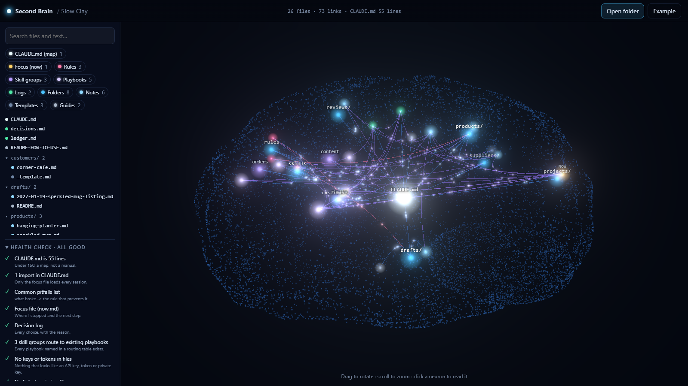
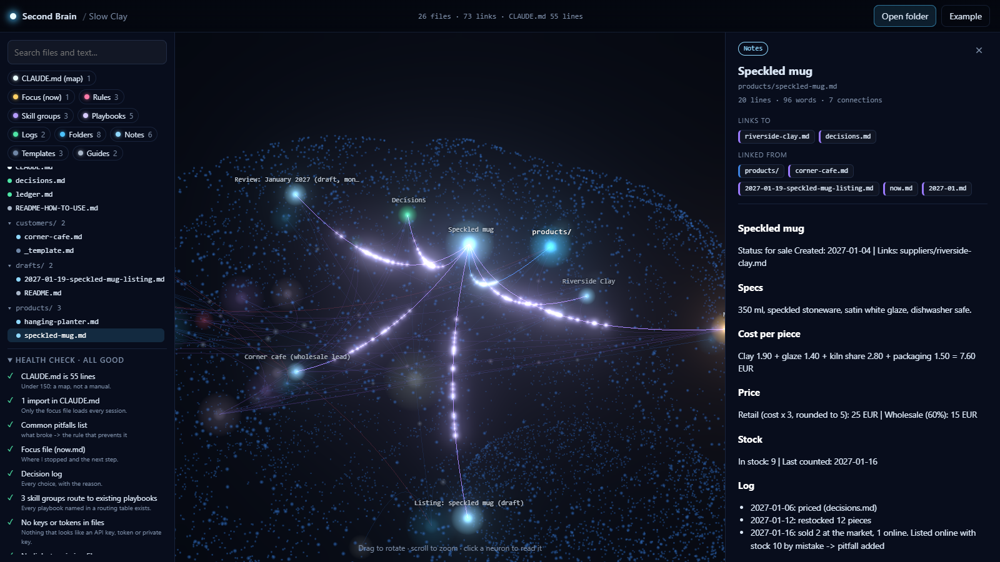

# Second Brain Kit

A Claude Code skill that builds a **second brain** for any project, and a viewer that shows it as a living neural map.

A second brain is a small set of files that Claude reads at the start of every session: what the project is, where things live, what is always true, where you stopped, and what you decided and why. You stop re-explaining your project. Claude stops forgetting rules after a long chat.

It works for anything you keep coming back to: an app, a codebase, a small business, a thesis, a book, a job search, a course, a renovation.



## What's inside

| Part | What it does |
|---|---|
| `skills/second-brain/` | The skill. It interviews you, designs the structure around your work, shows you the plan, and writes the files once you approve. It can also **audit** an existing brain. |
| `viewer/` | An interactive map of your brain that updates by itself as files change. Click any file to read it and follow its links. Includes a health check. Prebuilt: say "open my second brain". |
| `examples/ceramics-shop/` | A complete example brain for a one-person ceramics shop. |

## Install the skill

**As a plugin:**

```
/plugin marketplace add owlinthebarnai/second-brain-kit
/plugin install second-brain@second-brain-kit
```

**Or copy it by hand.** Put the `skills/second-brain` folder in `~/.claude/skills/` (all projects) or in `<your-project>/.claude/skills/` (one project):

```bash
git clone https://github.com/owlinthebarnai/second-brain-kit
cp -r second-brain-kit/skills/second-brain ~/.claude/skills/
```

## Use it

Open Claude Code in the folder you want the brain in and say what it is for:

> Set up a second brain for my freelance design business

Claude asks about 10 short questions in one message, including:
- what you keep (clients? chapters? experiments?)
- what you do again and again
- how often you want to review
- whether anything is public
- whether money is involved

Then it shows you the file tree, the skills it will create and the rules it will write, and **waits for your OK** before writing anything.

Later:

> Audit my second brain

This checks:
- whether `CLAUDE.md` is still under 150 lines
- whether files contradict each other
- notes that point to files that no longer exist
- skills whose playbooks are missing
- keys that leaked into files

## What a second brain looks like

```
CLAUDE.md                 the map: under 150 lines, loaded every session
CLAUDE.local.md           private notes (gitignored)
projects/now.md           focus, where I stopped, next step (the only import)
decisions.md              date | decision | reason
ledger.md                 costs and revenue, if money is involved
<your areas>/             one folder per kind of thing you keep, each with a _template.md
.claude/rules/            rules that load only when Claude works in a folder
.claude/skills/rhythm/    session-close + review
.claude/skills/<yours>/   one group per set of tasks you repeat
```

## The principles

The skill follows these, and writes the ones that apply into your `CLAUDE.md`. The full list is in [principles.md](skills/second-brain/principles.md).

1. **CLAUDE.md is a map, not a manual.** 150 lines max. Folder rules go in `.claude/rules/`, procedures go in skills.
2. **Import one file only:** `projects/now.md`. Look everything else up when needed.
3. **If it matters, it goes in a file.** Chat instructions vanish after compaction.
4. **Every decision gets a reason.** Real numbers only: missing data is a question, never an estimate.
5. **Memory can be stale.** Check that a file still exists before acting on a note that points to it.
6. **Pitfalls become rules:** `what broke -> the rule that prevents it`.
7. **A sentence is not enforcement.** Anything critical needs a hook or permission rule.
8. **Plan before building or spending.** Outline, then wait for an OK.
9. **Close every session.** Paste raw notes; Claude files them.
10. **Secrets only in environment variables. Private notes only in CLAUDE.local.md.**

## The viewer

Ask Claude, in the folder with your brain:

> Open my second brain

That's it. No install, no setup: the viewer ships prebuilt, and you only need [Node.js](https://nodejs.org) (18+).
- **Opens by itself:** Claude starts the viewer in the background and opens it in your browser.
- **Stays up to date:** the map updates by itself about a second after any file changes, like a session close, a new note or an edit. It keeps your place (open file, filters, search, camera) and flashes what changed.
- **Keeps running:** it stays on after you close Claude. Ask again any time and it reuses the same page.
- **Private:** it listens on `127.0.0.1` only, so your brain is never visible to other devices.
- **Stop it:** say "stop the viewer".
- **Start at login:** ask Claude "keep the viewer running when I log in".

Without Claude, run this from the kit folder:

```bash
node viewer/scripts/open.mjs "/path/to/your/brain"     # start + open (default: current folder)
node viewer/scripts/open.mjs --stop "/path/to/your/brain"
```

To try it with the example: `node viewer/scripts/open.mjs examples/ceramics-shop`. Or click **Open folder** in the viewer (or drag a folder onto the page) to load any brain straight from your disk.

What you can do:
- **Navigate:** drag to rotate, scroll to zoom, click a neuron (or a file in the tree) to read it. Links are clickable, and `Esc` goes back. Press `/` to search.
- **Read the colours:** white is `CLAUDE.md`, gold is the focus file, pink is rules, violet is skills and playbooks, green is logs, blue is folders and notes.
- **Read the links:** blue means a folder contains a file, purple means a file mentions another, pink means a rule applies to a folder, and gold is the `CLAUDE.md` import.
- **Health check:** shows the `CLAUDE.md` line count, imports, the pitfalls list, the focus file, the decision log, skill routing, leaked keys and links to missing files.



Built with Vite, Three.js and marked. To change the viewer: `cd viewer && npm install && npm run dev`, then `npm run build` to update `viewer/dist`.

## License

MIT
